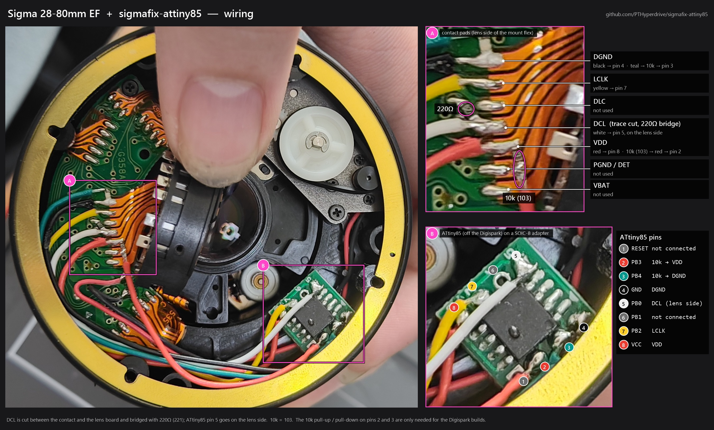

# sigmafix for ATtiny85

This is an ATtiny85 port of [sigmafix](https://github.com/marcan/sigmafix) by
Hector Martin ([marcan](https://github.com/marcan)), a DIY modchip that makes
older Sigma lenses with a Canon EF mount work on newer Canon bodies.

The original design, the EF protocol analysis and the firmware are all marcan's
work. This repository only moves the code to the ATtiny85 (and to GNU as
syntax), for anyone who has an ATtiny85 or a Digispark board at hand instead of
an ATtiny13. See the [original README](https://github.com/marcan/sigmafix#readme)
for the full explanation of the problem and of how the fix works.

Tested on a Sigma 28-80mm with a Canon EOS 850D, using the chip from a
Digispark board flashed with the `sigmafix_digispark_instant` build.

## The problem, in short

Canon EF lenses accept both `12 YY` and `13 YY` to move the aperture by `YY`
steps. Older Canon bodies send `12`, newer ones send `13`, and older Sigma
lenses only understand `12`. On a newer body such a lens works wide open but
gives Err 01 as soon as it has to stop down. The chip listens to the bus and,
when it sees command `13`, pulls DCL low during its last bit, so the lens
receives `12` instead.

## Changes from the ATtiny13 version

The protocol handling is unchanged. What differs:

* LCLK is on PB2 (pin 7) instead of PB1 (pin 6), because INT0 is on PB2 on the
  ATtiny85.
* TIMER0_OVF is interrupt vector 5 (vector 3 on the ATtiny13), `TIMSK0`/`TIFR0`
  are called `TIMSK`/`TIFR`, and the high byte of the stack pointer is set.
* It runs from the 8 MHz internal RC oscillator (9.6 MHz on the ATtiny13). The
  700µs time-out and the ~1µs hold after the rewritten bit follow `F_CPU`.
* The watchdog is turned off at reset, in case a bootloader left it running.
* It is written for avr-gcc / GNU as instead of avra.
* There are optional builds for a chip taken off a Digispark board (see below).

## Builds

All builds come from `sigmafix_t85.S`:

| File | Flags | For | Clock | Sleep mode |
|---|---|---|---|---|
| `sigmafix_t85.hex` | | bare ATtiny85, flashed via ISP | 8 MHz internal RC | power-down |
| `sigmafix_digispark.hex` | `-DDIGISPARK` | Digispark chip, flashed over USB | 16.5 MHz PLL | idle |
| `sigmafix_digispark_instant.hex` | `-DDIGISPARK -DBYPASS_BOOTLOADER` | same, without the 5 s bootloader delay | 16.5 MHz PLL | idle |

`sigmafix_t85` is the closest to the original and the one to use if you can
program the chip over ISP. It has not been tested in a lens yet. Like the
original, it has debug outputs on PB3 (pin 2, high while a command byte is
being handled) and PB4 (pin 3, high while awake).

## Building

You need avr-gcc and avr-libc (the toolchain that comes with the Arduino IDE
works). Then type `make`, or build by hand:

```
avr-gcc -mmcu=attiny85 -x assembler-with-cpp -nostartfiles -nostdlib -o sigmafix_t85.elf sigmafix_t85.S
avr-objcopy -O ihex -j .text sigmafix_t85.elf sigmafix_t85.hex
```

Add `-DDIGISPARK`, or `-DDIGISPARK -DBYPASS_BOOTLOADER`, for the Digispark
builds. Each build is 768 bytes.

## Flashing

### Bare ATtiny85 (ISP)

`make flash` writes the firmware and the fuses with avrdude. It defaults to the
`usbtiny` programmer; use `make flash PROGRAMMER=foo` to change it. If you
program the chip another way, don't forget the fuses:
`LFUSE=0xe2 HFUSE=0xdd EFUSE=0xff` (8 MHz internal RC without the clock
divider, brown-out detection at 2.7 V).

A chip taken off a Digispark can be programmed this way too; the chip erase
removes the bootloader.

### Digispark (USB)

`make flash-digispark` or `make flash-digispark-instant`, then plug the board
in when asked. This uses the [micronucleus](https://github.com/micronucleus/micronucleus)
command line tool. On Windows the bootloader (USB ID `16D0:0753`) needs the
libusb-win32 driver, which you can install with [Zadig](https://zadig.akeo.ie/).

After flashing, desolder the chip from the board and put it in the lens. Things
to know:

* **Power draw.** On the PLL clock, waking up from power-down is too slow to
  catch the first bit of a command, so the Digispark builds sleep in idle mode
  and draw a few mA whenever the lens is powered, instead of microamps. Check
  whether your camera keeps VDD on when it is switched off (measure VDD to DGND
  with the lens mounted and the camera off). If it does, use the bare-chip
  build over ISP instead.
* **The 5 s delay.** The micronucleus 1.x bootloader on Digispark boards waits
  about 5 s on every power-up before starting the program, and the fix does
  nothing during that time.
* **The instant build removes the bootloader for good.** On its first run,
  `sigmafix_digispark_instant` rewrites flash page 0 so that the reset and
  PCINT0 vectors point to this program instead of the bootloader, then blinks
  the LED on P1 three times. From then on the chip starts immediately, but it
  **can only be reprogrammed with an ISP programmer**. Plugged into USB
  afterwards, the board shows up as an unknown device whose descriptor request
  failed; that is expected. Tested with micronucleus 1.6.
* **Pins 2 and 3.** The Digispark builds leave PB3 and PB4 (the USB lines) as
  inputs, and they float once the chip is off the board. Tie pin 2 (PB3) to VCC
  and pin 3 (PB4) to GND through 10kΩ resistors. With the plain
  `sigmafix_digispark` build this also makes the bootloader see an idle USB bus
  and start the program when its time-out expires.

## Installation

Cut the DCL line between the camera contact and the lens board, bridge the cut
with a 220Ω resistor, and connect the ATtiny85 as follows:

```
                                           Camera side
                            =========================================
                            DGND  LCLK  DLC  DCL  VDD  PGND/DET  VBAT
                             |     |     |    |    |      |       |
  ,-----------------------+------------------------+      |       |
  |           ATtiny85    |  |     |     |    |    |      |       |
  |          __________   |  |     |     |    |    |      |       |
  |         |o         |  |  |     |     |    \    |      |       |
  |        1|RESET  VCC|8-'  |     |     | 220/    |      |       |
  `-[10k]--2|PB3    PB2|7----------+     |  Ω \    |      |       |
  ,-[10k]--3|PB4    PB1|6    |     |     |    /    |      |       |
  +--------4|GND    PB0|5---------------------+    |      |       |
  |         |__________|     |     |     |    |    |      |       |
  `--------------------------+     |     |    |    |      |       |
                             |     |     |    |    |      |       |
                            DGND  LCLK  DLC  DCL  VDD  PGND/DET  VBAT
                            =========================================
                                            Lens side
```

The two 10kΩ resistors (marked `103`) are for the Digispark builds only, which
leave PB3 and PB4 floating. With the bare-chip build, leave pins 2 and 3
unconnected: they are debug outputs there, and the pull-up on pin 2 would waste
current.

PB0 must connect on the lens side of the resistor. The chip only drives DCL low
during the one bit it changes, and the resistor is what lets it override the
camera there. The rest of the time PB0 is an input, so the signal passes through
the resistor unchanged, and a chip that is not running leaves the lens working
as it did before.

DCL is the middle one of the seven lens contacts. LCLK is the second contact
from the DGND end, so check which end that is before soldering.

This is how it looks in a Sigma 28-80mm, with the chip taken off a Digispark
and soldered to a SOIC-8 adapter board:



marcan's [photo of an install](https://github.com/marcan/sigmafix/blob/master/sigmafix_lens_diagram.jpg)
shows another way to fit it inside a lens. Note that the SOIC-8 ATtiny85 (ATtiny85-20SU)
is the wide 5.3 mm body, bigger than the 3.9 mm ATtiny13A-SSU.

Before closing the lens, take a few shots stopped down (f/8, f/11, the smallest
aperture) and try the depth-of-field preview: the blades should move and there
should be no Err 01.

## Credits

* [sigmafix](https://github.com/marcan/sigmafix) by Hector Martin "marcan": the
  original design, firmware, documentation and the table of EF command lengths.
* marcan's [notes on the Canon EF protocol](https://gist.github.com/marcan/858c242db2fc595da1e0bb70a05192fc).

## License

MIT, same as the original. See [LICENSE](LICENSE).
